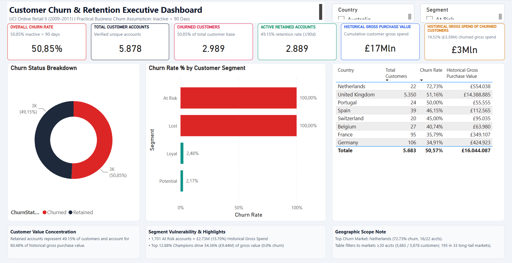
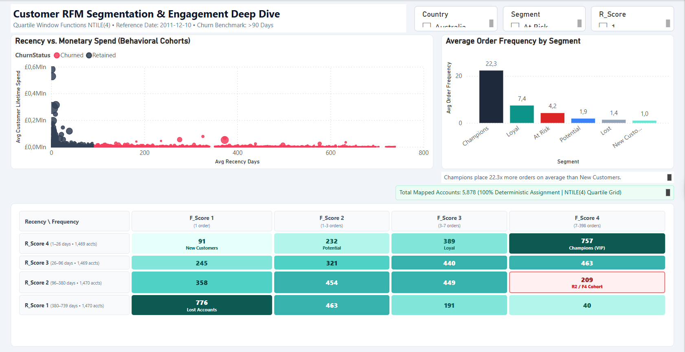

# Customer Churn & RFM Segmentation Analysis

An end-to-end data analytics portfolio project combining **SQL data transformation and analytics**, **statistical RFM segmentation**, and an interactive **Power BI executive dashboard** to analyze customer retention, quantify historical gross spend exposure, and guide marketing intervention on the **UCI Online Retail II dataset** (1M+ transactional records).

---

## Dashboard Preview

| Executive Churn Overview (Page 1) | RFM Deep Dive & Matrix (Page 2) |
| :---: | :---: |
|  |  |

---

## 1. Project Overview

In non-contractual e-commerce, customer churn occurs silently without explicit contract termination. Businesses frequently invest heavily in broad acquisition campaigns while existing high-value customers lapse undetected. This project establishes an automated, end-to-end analytics workflow that extracts, cleans, and transforms raw transactional logs into behavioral customer cohorts, isolates historical gross spend exposure, and equips stakeholders with actionable retention strategies.

---

## 2. Business Problem

* **Silent Attrition:** Without proactive tracking, e-commerce retailers cannot distinguish between naturally irregular buying cycles and permanent customer defection.
* **Value Asymmetry:** Customer purchase value is highly concentrated among a relatively small group of high-value accounts. Understanding the retention patterns of these customers is therefore important for prioritizing customer relationship management efforts.
* **Untargeted Marketing:** Without customer-level behavioral segmentation, marketing teams may struggle to distinguish active loyal customers from inactive or at-risk accounts when prioritizing re-engagement efforts.

---

## 3. Objectives

1. **Clean & Standardize:** Build a robust, deduplicated SQL data hygiene pipeline for 1.06M raw retail transactions.
2. **Behavioral Segmentation:** Compute Recency, Frequency, and Monetary metrics evaluated against reference date `2011-12-10`, deriving deterministic `NTILE(4)` quartile scores.
3. **Quantify Attrition:** Apply a practical 90-day retail inactivity benchmark to classify churn and measure historical financial exposure.
4. **Actionable BI:** Develop a native, interactive 2-page Power BI dashboard featuring dynamic cross-filtering, KPI cards, dynamic RFM density matrix, and geographic analysis.

---

## 4. Dataset Description & Source

* **Dataset:** [UCI Machine Learning Repository — Online Retail II](https://archive.ics.uci.edu/dataset/502/online+retail+ii)
* **Time Span:** December 1, 2009 – December 9, 2011 (24 months)
* **Raw Size:** 1,067,371 rows across two annual sheets
* **Domain:** UK-based registered non-store online retailer selling unique all-occasion giftware (primarily wholesale and direct consumer).
* **Attributes:** `Invoice`, `StockCode`, `Description`, `Quantity`, `InvoiceDate`, `Price`, `CustomerID`, `Country`.

> **Dataset Storage Note:** In accordance with Git version control best practices, the raw 45.6 MB Excel file is excluded via `.gitignore`. Complete download and automated ingestion instructions are documented in [`data/raw/README.md`](data/raw/README.md). All cleaned data is pre-packaged in [`data/processed/customer_churn_rfm.csv`](data/processed/customer_churn_rfm.csv).

---

## 5. Tools & Technologies

* **SQL Engine:** SQLite 3.x (the actual engine tested and executed for this project). Script headers include ANSI-SQL syntax adaptation guidance for PostgreSQL, Microsoft SQL Server, and MySQL, provided as reference notes rather than verified implementations.
* **Core SQL Features:** CTEs, Window Functions (`ROW_NUMBER()`, `NTILE(4)`), Date Arithmetic (`julianday`), Deterministic Tie-Breaking
* **Business Intelligence:** Microsoft Power BI Desktop (VertiPaq Data Engine, 20 Custom DAX Measures, Dynamic Cross-Filtering)
* **Data Storage & Exchange:** CSV, SQLite Database
* **Version Control:** Git, GitHub

---

## 6. Methodology & End-to-End Workflow

```
Raw Transaction Logs (1,067,371 rows across 2 sheets)
   │
   ▼
Database Ingestion ────────────────────> Import raw transactions into SQLite table `raw_retail`
   │
   ▼
Phase 1: SQL Data Cleaning ────────────> Exclude null IDs, cancellations ('C%'), zero prices; deduplicate lines (779,423 rows)
   │
   ▼
Phase 2: Customer Aggregation ─────────> Aggregate to 5,878 accounts; deterministic latest country; compute discrete RFM
   │
   ▼
Phase 3: Quartile Scoring ─────────────> Deterministic NTILE(4) quartile scoring with CustomerID tie-breaker
   │
   ▼
Phase 4: Behavioral Segments ──────────> Apply 90-day inactivity threshold + 6 mutually exclusive customer segments
   │
   ▼
Phase 5: Executive Power BI ───────────> VertiPaq tabular model, 20 DAX measures, 2-page executive report
```

---

## 7. SQL Pipeline

The SQL transformation pipeline is organized modularly in the [`sql/`](sql/) directory:

1. [`sql/01_data_cleaning.sql`](sql/01_data_cleaning.sql):
   * **Guest Checkouts:** Removed 243,007 rows with NULL `CustomerID`.
   * **Cancellations & Returns:** Excluded 19,494 cancellation rows (`Invoice LIKE 'C%'`) and 22,950 non-positive quantities.
   * **Invalid Prices:** Removed 6,207 zero/negative unit prices (adjustments and samples).
   * **Deduplication:** Removed 26,126 duplicate lines across 24,714 groups via `ROW_NUMBER()`. 24,712 groups were 100% identical; 2 differed only by trailing whitespace.
   * **Revenue Convention:** Throughout this pipeline, `Monetary` represents **Historical Gross Purchase Value**. Unlinked credit notes prevent true net revenue derivation without distorting RFM quartiles.
2. [`sql/02_rfm_segmentation.sql`](sql/02_rfm_segmentation.sql):
   * **Deterministic Country Resolution:** Exactly 13 customers (0.22%) ordered across multiple countries. Resolved deterministically by assigning each account to the country of their **most recent transaction** via window ranking.
   * **Discrete Calendar Arithmetic:** Wrapped dates in `date()` to strip time components, preventing fractional decimal recency.
3. [`sql/03_churn_and_segments.sql`](sql/03_churn_and_segments.sql):
   * Computes churn flags and assigns the 6-tier customer segmentation hierarchy.
4. [`sql/04_analysis_queries.sql`](sql/04_analysis_queries.sql):
   * Runs the 4 executive analysis queries exported to [`data/processed/`](data/processed/).

---

## 8. RFM Methodology

Evaluated on **December 10, 2011** (the day following the final transaction in the dataset):
* **Recency (R):** Elapsed calendar days between `2011-12-10` and customer's latest purchase date.
* **Frequency (F):** Count of distinct, valid order invoices placed by the customer.
* **Monetary (M):** Total historical gross purchase value across all valid orders.

### Quartile Scoring (`NTILE(4)`) & Tie-Break Mechanism:
Each metric is segmented into 4 quartiles (1 = Lowest/Worst, 4 = Highest/Best) using deterministic secondary sorting:
```sql
NTILE(4) OVER (ORDER BY Recency DESC, CustomerID ASC) AS R_Score,
NTILE(4) OVER (ORDER BY Frequency ASC, CustomerID ASC) AS F_Score,
NTILE(4) OVER (ORDER BY Monetary ASC, CustomerID ASC) AS M_Score
```

| Quartile Score | Observed Recency (R) Range | Observed Frequency (F) Range | Observed Monetary (M) Range |
| :---: | :---: | :---: | :---: |
| **Score 1** | 380 to 739 days | 1 order (1,470 accounts) | £2.95 to £342.24 |
| **Score 2** | 96 to 380 days | 1 to 3 orders (153 single-order; 1,317 multi-order) | £342.40 to £868.37 |
| **Score 3** | 26 to 96 days | 3 to 7 orders | £868.77 to £2,248.50 |
| **Score 4** | 1 to 26 days | 7 to 398 orders | £2,249.52 to £580,987.04 |

> **Important Note on Observed Ranges & Boundary Ties:** 
> The metric ranges above represent **observed minimum and maximum values** within each quartile bucket, not mutually exclusive hard numerical thresholds. 
> Because SQLite's `NTILE(4)` partitions ordered rows into four equal-sized buckets of ~1,470 accounts each, customers with identical metric values (e.g. Recency of exactly 26, 96, or 380 days, or Frequency of 1 or 3 orders) are split across adjacent quartiles using the deterministic tie-breaker `CustomerID ASC`. Consequently, observed boundary values appear contiguous or overlapping across quartile summaries. Downstream segmentation rules (such as `New Customers`) explicitly evaluate raw values (`Frequency = 1`) to ensure behavioral accuracy.

---

## 9. Churn Definition

> **Business Assumption:** For the purpose of this analysis, customers inactive for more than **90 days** as of `2011-12-10` are classified as **Churned**. This threshold was selected as a practical business assumption for a non-contractual retail setting, aligning with typical quarterly replenishment cycles.

$$\text{IsChurned} = \begin{cases} 1 & \text{if } \text{Recency} > 90 \text{ days} \\ 0 & \text{if } \text{Recency} \le 90 \text{ days} \end{cases}$$

This is a descriptive classification heuristic reflecting historical inactivity, not a predictive machine learning forecast.

---

## 10. Customer Segmentation

Customers are categorized into 6 mutually exclusive behavioral segments evaluated in strict priority order:

| Segment | SQL Classification Rule | Accounts | Churn Rate | Avg Orders | Avg Spend | Total Gross Purchase Value | % Gross Value Share |
| :--- | :--- | :---: | :---: | :---: | :---: | :---: | :---: |
| **Champions** | `R_Score = 4 AND F_Score = 4` | 757 | **0.0%** | 22.3 | £12,476.76 | £9,444,906.76 | **54.36%** |
| **Loyal** | `R_Score >= 3 AND F_Score >= 3` | 1,292 | **2.5%** | 7.4 | £2,979.99 | £3,850,157.88 | 22.16% |
| **Potential** | `R_Score >= 3 AND F_Score <= 2` | 785 | **2.2%** | 1.9 | £924.87 | £726,021.89 | 4.18% |
| **New Customers** | `R_Score = 4 AND Frequency = 1` | 104 | **0.0%** | 1.0 | £323.62 | £33,656.58 | 0.19% |
| **At Risk** | `ELSE 'At Risk'` (Remaining accounts) | 1,701 | **100.0%** | 4.2 | £1,603.58 | £2,727,681.60 | **15.70%** |
| **Lost** | `R_Score = 1 AND F_Score <= 2` | 1,239 | **100.0%** | 1.4 | £477.67 | £591,827.69 | 3.41% |
| **Total Base** | *Reconciled sum across all cohorts* | **5,878** | **50.85%** | **6.3** | **£2,955.81** | **£17,374,252.40** | **100.00%** |

> **Segment Logic Clarification for At Risk:**
> The `At Risk` segment captures all accounts not matched by the earlier CASE rules. In practice, this comprises two specific cohorts:
> 1. All customers with `R_Score = 2` across all frequency levels (1,470 accounts, Recency 96–380 days).
> 2. Customers with `R_Score = 1` and `F_Score >= 3` (231 accounts, Recency 380–739 days, multi-order historical power buyers).
>
> Together, these form the **1,701 At Risk accounts**. Note that the segment spans recency from 96 up to 739 days, not exclusively 96–380 days.

---

## 11. Key Business Findings

### Finding 1: Extreme Value Concentration Among Champions
* **Supporting Metric:** 757 Champion accounts represent **12.88%** of the customer base but account for **54.36% (£9.44M)** of Historical Gross Purchase Value, averaging 22.3 orders and £12,477 spend with 0.0% churn.
* **Business Interpretation:** Historical gross purchase value exhibits severe concentration: over half of cumulative sales volume is generated by just 12.88% of the customer base. While these high-frequency buyers represent the core historical revenue engine, ongoing business health also requires monitoring pipeline replenishment from newer cohorts.
* **Recommended Action:** Establish a dedicated VIP loyalty tier featuring bespoke pricing, dedicated account management, and early access to high-demand inventory.
* **Potential Limitation:** High-volume accounts with bulk ordering schedules may exhibit different seasonal purchasing patterns than individual retail consumers.

### Finding 2: Customer Value Concentration Between Cohorts
* **Supporting Metric:** Retained customers represent 49.15% of the customer base and account for 80.48% (£13.98M) of historical gross purchase value, while churned accounts account for £3.39M (19.52%). Retained buyers order **3.15× more often** (9.6 vs. 3.1 orders) and spend **4.27× more** (£4,840 vs. £1,135).
* **Business Interpretation:** The customer base exhibits strong Customer Value Concentration: retained accounts represent 49.15% of customers and account for 80.48% of historical gross purchase value. While preserving existing accounts protects the majority of historical spend volume, determining whether retention is more cost-effective than acquisition would require customer acquisition cost (CAC), marketing spend, and margin data, which are not present in transactional logs.
* **Recommended Action:** Prioritize retention touchpoints for active accounts showing deceleration in purchase intervals, deploying automated re-engagement before buyers reach the 90-day threshold.
* **Potential Limitation:** Gross spend figures exclude returns, slightly overstating cash collections if return rates differ between cohorts.

### Finding 3: £2.73M Historical Gross Spend of At-Risk Customers
* **Supporting Metric:** 1,701 accounts in the "At Risk" segment account for **£2,727,681.60 (15.70%)** in Historical Gross Spend of At-Risk Customers, averaging 4.2 previous orders.
* **Business Interpretation:** These are proven repeat buyers who have crossed into churn territory (recency 96–380 days for R=2, and 380–739 days for R=1 with F≥3). They understand the product catalog but have stopped purchasing. Note: This metric represents historical cumulative spending, not guaranteed future revenue at risk.
* **Recommended Action:** Deploy automated win-back triggers at day 60 and day 75 offering tailored discounts on previously purchased product categories.
* **Potential Limitation:** A subset of these accounts may represent annual holiday shoppers who naturally purchase once every 12 months.

### Finding 4: Cross-Border Attrition Spike in the Netherlands
* **Supporting Metric:** The Netherlands recorded the highest churn rate among major markets at **72.73%** (16 of 22 accounts lapsed) despite generating £554,038.09 in Historical Gross Purchase Value (£25,183 average account spend).
* **Business Interpretation (Hypothesis):** Dutch accounts disengage at higher rates (72.73%) than domestic UK accounts (51.16%). This pattern suggests potential cross-border fulfillment friction, delivery timeframes, or shipping costs to investigate, but operational shipping logs and margin data would be required to establish root causes.
* **Recommended Action:** Audit international logistics, delivery timeframes, and overseas freight thresholds specifically for Benelux accounts.
* **Potential Limitation:** Sample size is relatively small (22 accounts), meaning individual client decisions heavily shift percentage metrics.

---

## 12. Power BI Dashboard

The native Power BI workbook ([`power_bi/Customer_Churn_Analysis.pbix`](power_bi/Customer_Churn_Analysis.pbix)) is structured into two executive reporting pages matching the preview screenshots 1:1:

### Page 1 — Executive Churn Overview
* **Top KPI Metric Cards:**
  - `OVERALL CHURN RATE`: **50.85%** (2,989 inactive accounts >90d)
  - `TOTAL CUSTOMER ACCOUNTS`: **5,878** verified unique accounts
  - `CHURNED CUSTOMERS`: **2,989** churned accounts (50.85% of total customer base)
  - `ACTIVE RETAINED ACCOUNTS`: **2,889** active accounts (49.15% retention rate ≤90d)
  - `HISTORICAL GROSS PURCHASE VALUE`: **£17.37M** cumulative customer gross purchase value
  - `HISTORICAL GROSS SPEND OF CHURNED CUSTOMERS`: **£3.39M** (19.52% of total historical gross spend)
* **Interactive Slicers:** Country and Segment slicers for cohort filtering.
* **Core Visuals:**
  - *Churn Status Breakdown (Donut Chart):* Visualizes the customer base split between Retained (49.15%) and Churned (50.85%).
  - *Churn Rate % by Customer Segment (Bar Chart):* Highlights segment vulnerability (At Risk & Lost at 100%, Loyal at 2.48%, Potential at 2.17%, Champions & New Customers at 0%).
  - *Top Countries by Churn Rate (Table Visual):* Ranks major geographic markets (min. 20 accounts) in descending order of Churn Rate, displaying Total Customers, Churn Rate, and Historical Gross Purchase Value (led by Netherlands at 72.73% churn). Highlights why the table totals 5,683 rather than 5,878 customers (the remaining 195 accounts reside across 33 long-tail international markets with <20 accounts).

### Page 2 — RFM Deep Dive & Customer Segmentation Matrix
* **Interactive Slicers:** Country, Segment, and R_Score filters for focused cohort exploration.
* **Core Visuals:**
  - *Recency vs. Monetary Spend (Scatter Chart):* Plots customer inactivity against historical gross spend on a logarithmic scale, colored by Churn Status with bubble size representing order frequency.
  - *Average Order Frequency by Segment (Column Chart):* Compares purchasing intensity across segments (Champions at 22.3 orders down to New Customers at 1.0 order, a 22.3× differential).
  - *RFM Customer Density Heatmap Matrix (4 × 4 Grid):* Dynamic DAX-driven cell densities, quadrant cards, and VIP/Risk indicators (including the "R2 / F4 Cohort" with 209 lapsed accounts and observed Recency ranges R4: 1–26d, R3: 26–96d, R2: 96–380d, R1: 380–739d), fully responsive to all slicer selections.

### Core DAX Measures (Embedded in Model):
The following 14 core DAX measures are documented below, out of 20 measures implemented in the Power BI model:
```dax
Total Customers = COUNTROWS('customer_churn_rfm')

Churned Customers = 
CALCULATE(COUNTROWS('customer_churn_rfm'), 'customer_churn_rfm'[IsChurned] = 1)

Retained Customers = 
CALCULATE(COUNTROWS('customer_churn_rfm'), 'customer_churn_rfm'[IsChurned] = 0)

Churn Rate = DIVIDE([Churned Customers], [Total Customers], 0)

Retention Rate = DIVIDE([Retained Customers], [Total Customers], 0)

Historical Gross Purchase Value = SUM('customer_churn_rfm'[Monetary])

Historical Gross Spend of Churned Customers = 
CALCULATE(SUM('customer_churn_rfm'[Monetary]), 'customer_churn_rfm'[IsChurned] = 1)

Historical Gross Spend of At-Risk Customers = 
CALCULATE(SUM('customer_churn_rfm'[Monetary]), 'customer_churn_rfm'[Segment] = "At Risk")

Historical Gross Spend of Retained Customers = 
CALCULATE(SUM('customer_churn_rfm'[Monetary]), 'customer_churn_rfm'[IsChurned] = 0)

Pct Gross Spend of Churned Customers = 
DIVIDE([Historical Gross Spend of Churned Customers], [Historical Gross Purchase Value], 0)

Avg Recency Days = AVERAGE('customer_churn_rfm'[Recency])

Avg Order Frequency = AVERAGE('customer_churn_rfm'[Frequency])

Avg Customer Lifetime Spend = AVERAGE('customer_churn_rfm'[Monetary])

Avg Order Value = AVERAGE('customer_churn_rfm'[AvgOrderValue])
```

---

## 13. Limitations

1. **Gross vs. Net Spend:** Returns and cancellations were excluded because credit memos lacked parent-invoice relational keys in the source data.
2. **Fixed 90-Day Inactivity Benchmark:** In non-contractual retail, customers do not explicitly cancel; annual or seasonal buyers may be classified as churned before their natural annual replenishment.
3. **Descriptive, Not Predictive:** This project establishes diagnostic and descriptive behavioral benchmarks; predictive scoring (e.g. survival analysis or classification trees) is a logical future step.
4. **Absence of Cost and Logistics Data:** Profitability claims and supply chain explanations remain exploratory hypotheses due to the absence of cost-of-goods-sold (COGS), shipping time logs, and marketing acquisition costs.

---

## 14. How to Reproduce the Analysis

### Step 1: Database Setup (Optional)
If you wish to re-execute data cleaning and RFM scoring directly from raw source data:
1. Download `online_retail_II.xlsx` from the [UCI Machine Learning Repository](https://archive.ics.uci.edu/dataset/502/online+retail+ii).
2. Note that the standard SQLite CLI `.import` command accepts delimited text (CSV), not proprietary multi-sheet `.xlsx` workbooks. Export both annual sheets (`Year 2009-2010` and `Year 2010-2011`) to CSV, concatenate them (retaining the header on the first file), and import the consolidated CSV into SQLite table `raw_retail` (or import directly via DB Browser for SQLite / DBeaver table import wizard).

> [!NOTE]
> You do not need to download or convert the raw Excel file to evaluate this project. The fully validated, cleaned, and segmented customer dataset is pre-packaged in [`data/processed/customer_churn_rfm.csv`](data/processed/customer_churn_rfm.csv) and is pre-embedded inside [`power_bi/Customer_Churn_Analysis.pbix`](power_bi/Customer_Churn_Analysis.pbix).

### Step 2: Execute SQL Pipeline
Execute scripts sequentially in SQLite (or port to PostgreSQL/SQL Server using the documented dialect notes):
```bash
sqlite3 online_retail_ii.db < sql/01_data_cleaning.sql
sqlite3 online_retail_ii.db < sql/02_rfm_segmentation.sql
sqlite3 online_retail_ii.db < sql/03_churn_and_segments.sql
sqlite3 online_retail_ii.db < sql/04_analysis_queries.sql
```

### Step 3: Open Power BI Dashboard
Open [`power_bi/Customer_Churn_Analysis.pbix`](power_bi/Customer_Churn_Analysis.pbix) in **Power BI Desktop** to inspect visualizations, dynamic matrix responsiveness, and DAX measures.

---

## 15. Author

* **Author:** Simone Angelo Vasilescu
* **Focus:** Data Analytics, SQL Data Transformation & Analytics, Business Intelligence, Customer Insights
* **GitHub:** [https://github.com/Simone0801](https://github.com/Simone0801)
